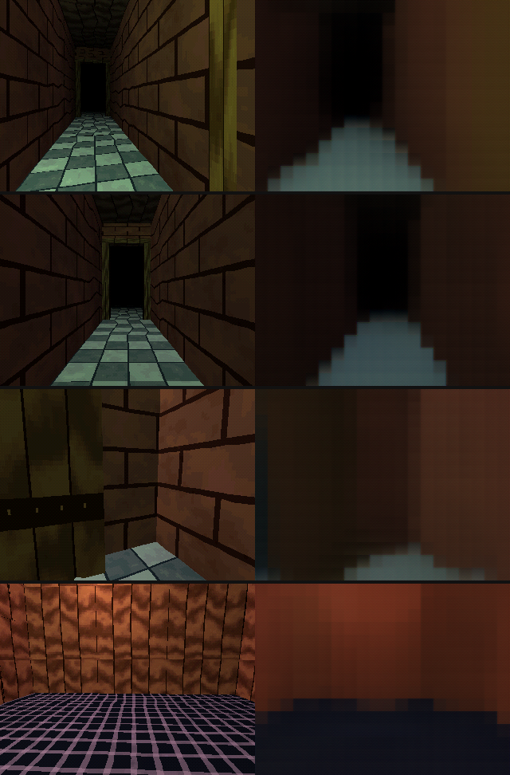

# neurofield

Train a network to render PS1-style first-person dungeons, in the spirit of
King's Field, from geometry + camera, and see what dream-like strangeness
comes out when it gets things wrong.



*Work in progress: the PS1 rasteriser (left) and the network (right) after
68,500 training steps, on frames of a walk through a level it never saw. It has
the layout, lighting and textures (bricks, tiles, wood grain, the wire grid),
softened and a little wavy; fine detail such as the door's iron bands and the
far end of a corridor still dissolves.*

## Code

One Cargo workspace:

- `engine/`: shared by everything below.
  - `world`: dungeons (generated or hand-built), props, doors, creatures, textures, light, walking.
  - `render`: the world on the GPU with the PS1 look (psx-bevy, from
    [bombpersons/psx](https://github.com/bombpersons/psx) in `external/psx`), creatures in
    full colour over it; in a window or headless.
  - `neural`: the trained network drawing the world instead, as WGSL compute shaders through wgpu.
- `training-data-gen/`: the `datagen` command, training data drawn by `engine::render`.
- `game/`: the game.
- `editor/`: the level editor.
- `psx-bevy/`: the psx template's crate, unedited (see `docs/template.md`).

## Training data (`training-data-gen/`)

The `datagen` command draws the engine's worlds with the game's own renderer,
without a window: affine textures, Gouraud vertex colours, vertex snapping,
dithering to 15-bit colour and fog, with creatures over the PS1 frame in full
colour. It needs a GPU adapter: Vulkan, or Mesa's software one (lavapipe,
`mesa-vulkan-drivers`) where there is none. Scenes are built on every core while
the GPU draws.

Levels are grids of rooms at different floor levels, joined by corridors that
climb between them by ramps or stairs, with lintels where ceilings change.
Indoors, corridors usually meet rooms through a door frame with the door
swung open against the wall. Rooms hold props and low-poly creatures in random
poses: skeletons, knights, ghouls and lizardmen (some giant, some armed),
four-legged beasts, slimes and floating eyes trailing tentacles. Every room is
reachable on foot (`cargo test` checks this over 300 levels).

Lighting is baked into vertex colours (ambient, sun, room lamps), plus a torch
carried with the camera that is added at render time, so it is part of each
view's parameters rather than the scene's.

On Linux, Bevy needs `pkg-config` and `libudev-dev` to build:

```bash
cargo build --release -p training-data-gen
```

```bash
target/release/datagen gen --out data/train --scenes 5000 --views 8 --shard-scenes 250
```

```bash
target/release/datagen walk --out data/walk0 --frames 1500 --seed 42
```

```bash
target/release/datagen textures --out data/textures.png
```

`gen` samples views from first-person walks by default (`--camera fp`): fixed
eye height and lens, no roll, gaze mostly level, turning to face the way it
walks and sometimes stopping to look around. `--camera free` gives random
cameras with varied height, tilt, roll and lens instead. `walk` writes one
continuous walk, as PNG frames plus the same arrays.

Twelve fixed 64x64 textures (eight for the level, three for creatures, one for
doors). Each shard holds `tris.npy`, `tri_offsets.npy`, `views.npy`, `images.npy` and a
`preview.png` contact sheet; `format.json` documents the layouts and the
shading. Scenes average about 650 triangles. One frame is 230 KB uncompressed,
so 1000 scenes × 8 views ≈ 1.9 GB, generated in about 13 s on 12 cores.

Rendering rules worth knowing when reading the data:
- Triangles are clipped at 0.02 tiles from the eye and depth-buffered; level
  triangles are split to quarter-tile pieces, so affine warping stays mild.
- Vertex colour 128/255 is neutral texture modulation; lighting is baked into
  the colours, the torch is added per vertex, and fog is applied per pixel by
  distance from the camera.
- Creatures are drawn over the PS1 frame in full colour at twice the resolution
  and averaged down; `masks.npy` marks pixels at least half covered.

## The neural renderer (`engine::neural`)

The game, editor and `datagen check` find the model, skins and textures through
`neurofield.ron` at the repository root; options of the same name override it.
`model.sh` puts a model where it says (`runs/model.safetensors`): it exports the
newest `runs/*/ckpt.pt` if needed (setting up `.venv` the first time), or without a
checkpoint of your own, downloads the trained model from the
[latest release](https://github.com/bombpersons/neurofield/releases/latest).

```bash
./model.sh
```

```bash
cargo run --release -p game -- --seed 7
```

By hand: export a checkpoint's weights (`train/export_weights.py`), and point the game at them:

```bash
.venv/bin/python train/export_weights.py --ckpt runs/colab2/ckpt.pt --out runs/colab2/model.safetensors
```

```bash
cargo run --release -p game -- --model runs/colab2/model.safetensors --seed 7
```

The network runs as hand-written WGSL compute shaders
(`engine/src/neural/gpu_net.wgsl`) through [wgpu](https://wgpu.rs): Vulkan, Metal or
DX12, in pure Rust. The whole frame is one submission of about 140 small kernels over
one buffer, with no per-shape compiling. On an RX 580 it takes about 10 ms a frame,
and it matches PyTorch to within 4e-6. When the model changes, the shaders change with
it: `datagen check --frames N --out DIR` writes the first N frames' tokens and network
images of a walk, to compare against `train/data.py` and PyTorch. With the same seed
the level and walk match `datagen walk --seed S`.

## Game (`game/`)

The start of the game: a first-person walk through a generated level drawn by the
network on the GPU, in [Bevy](https://bevyengine.org), with an
[egui](https://github.com/emilk/egui) panel to turn dream effects on in any
combination:

```bash
cargo run -p game -- --seed 7
```

Mouse to look, WASD to walk and strafe, Tab for the auto-walk, Space to switch to
the rasteriser, B for both side by side, H to hide the panel, N for a new level.
Esc frees the mouse to use the panel (click the view to look again; Esc again quits).
A gamepad works too: left stick to walk, right stick to look, d-pad to walk and turn.
`--level-file levels/x.ron` plays a hand-built level instead; E (or cross) opens
doors and pulls levers, and walking over a key picks it up.
A developer build (`--features dev-mcp`) can be driven headless through psx-bevy's
MCP with `--mcp --headless --software` (see docs/editor.md, Play).
For now the network's frame comes back to the CPU and goes up again as a texture.

## Level editor (`editor/`)

Hand-built dungeons on a grid, for playing and for teaching a generator what good
levels look like. See [docs/editor.md](docs/editor.md) for the design.

```bash
cargo run -p editor -- levels/demo.ron
```

A developer build (`--features dev-mcp`) has its own MCP for driving the editor's
mouse and keyboard from scripts, with or without a window: `--mcp --headless`
(see docs/editor.md, Developer MCP).

The psx crates come from a git submodule pinned to a known commit, so clone with:

```bash
git clone --recurse-submodules https://github.com/bombpersons/neurofield
```
